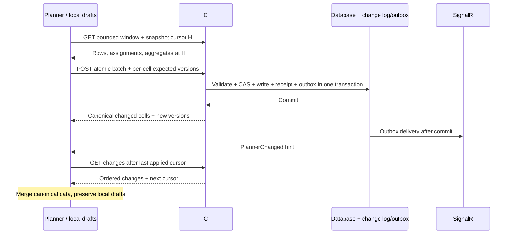

# Shift planner middleware interface - draft 0.1

Status: proposal for frontend/backend discussion, 2026-10-31. This document and [contracts.ts](contracts.ts) describe a suggested **v2** interface. They are not connected to the running app. The existing demo/v1 endpoints remain as implemented in `src/api/plannerApi.ts`.

Frontend skill model update (2026-11-11): the app now uses `Employee.areaSkills`, keyed
by area ID, with `notQualified`, `qualified`, `intermediate`, `experienced`, or `expert`.
Missing levels display as Not qualified. The credential/expiry and hard/soft skill
fields in this older v2 draft and its examples are superseded for the frontend;
that part of the proposed middleware contract still needs to be revised.

## Recommended design

Use **REST for reads and atomic batch writes**, a **durable cursor-based change feed for synchronization**, and **SignalR notifications to wake up the pull client**. Add a 30-second polling fallback and a five-minute conditional consistency check. The database remains behind the middleware.

The push message means "changes are available". The client fetches authoritative changes through REST. A missed message therefore delays refresh rather than losing a change. SignalR reconnect is useful transport recovery, but application replay, cursors and database consistency are our responsibility. Microsoft documents automatic reconnect and initial-start retry separately in its [SignalR JavaScript client guide](https://learn.microsoft.com/en-us/aspnet/core/signalr/javascript-client?view=aspnetcore-10.0).



Suggested numeric limits and intervals below are initial defaults, not guarantees. Expose negotiated values in `/references` and tune them after measuring the actual site size and database.

## Common conventions

Base URL: `/api/wiops/v2/sites/{siteId}/planner`.

- Authentication comes from the approved EVE/middleware integration. Prefer the existing same-origin session where appropriate; changing requests require the agreed CSRF protection. The server derives tenant and permissions from the session and authorizes the requested site on every endpoint and hub subscription.
- JSON property names are camelCase. `schemaVersion` is `"2.0"`; additive optional fields may evolve within v2. Unknown shift codes or incompatible versions are explicit errors, not silently converted to OFF.
- IDs are positive safe JSON integers, matching the current frontend IDs. If source IDs exceed `Number.MAX_SAFE_INTEGER`, standardize them as strings before implementation; do not mix encodings within v2.
- Cell identity is `(siteId, employeeId, date)`, enforced by a database unique constraint. One daily assignment per employee is the current model's limit. Split shifts would require a separately versioned extension.
- All date ranges are **inclusive `from`, exclusive `to`**. `date` is a site-calendar date, never a UTC-truncated timestamp. Event/update times are UTC instants.
- `version`, `planVersion`, `referenceVersion` and change cursors are opaque strings. Clients must not increment, subtract or lexically order them. Use cursors only with the server that issued them.
- Assignment versions protect individual cells. `planVersion` identifies the latest site plan revision, not a universal write lock. `referenceVersion` covers rules/configuration used in validation.
- Use resource-specific ETags for conditional reads of a window/reference response. An ETag, a database row version, a plan revision and a feed cursor serve different purposes and are not interchangeable.
- Errors use `application/problem+json` with application extensions such as `code`, `traceId`, `errors` and `conflicts`, following [RFC 9457](https://www.rfc-editor.org/rfc/rfc9457.html).

## Endpoint proposal

All paths below are relative to the base URL.

| Method | Path | Purpose |
| --- | --- | --- |
| GET | `/references` | Site clock/timezone, departments, areas, shifts, skills/requirements, rotation patterns, operating profiles, daily target rules, limits and source freshness |
| GET | `/windows` | Bounded employee/date snapshot, canonical assignments, overnight carry-in, full-scope aggregates |
| POST | `/assignments:batch` | Atomic put/delete of multiple cells with per-cell concurrency checks |
| GET | `/requests/{requestId}` | Resolve a timed-out batch/preview commit without guessing its outcome |
| GET | `/changes?after=...&limit=...` | Pull ordered committed changes; also used when push is unavailable |
| GET | `/ops-hours?from=...&to=...&departmentId=...&areaId=...` | Authoritative hourly scheduled presence and operating targets |
| POST | `/aggregates:preview` | Read-only projected KPI/absence/hourly aggregates with the supplied local draft operations |
| POST | `/planning-previews` | Validate manual/rotating bulk planning; may return an async job |
| GET | `/planning-previews/{previewId}` | Poll preview generation/status and retrieve the proposed changes |
| POST | `/planning-previews/{previewId}:commit` | Atomically commit a server-held, dependency-checked preview |
| PUT | `/rotation-patterns/{id}` | Versioned rotation configuration, with `If-Match` |
| PUT | `/operating-profiles/{id}` | Versioned per-department/area calendars and hourly targets, with `If-Match` |

Configuration writes need a separate permission from assigning shifts. Skill/employee/department master-data writes remain the responsibility of their existing owning services; the planner consumes their versions and notifications.

## Data required by the current UI

See exported DTOs in [contracts.ts](contracts.ts).

| Data | Fields / behavior |
| --- | --- |
| Site | `siteId`, IANA `siteTimeZone`, server-derived `siteToday`, `serverTime`, source synchronization status |
| Employee | Stable ID, name, department ID, role, shift group, authorized mobile/radio details, qualification records and record version |
| Area | ID, code and display name. It is a daily assignment destination, not a permanent employee department |
| Shift | E, L, N, OFF, S, P; working flag; local start/end times; overnight flag; definition version |
| Assignment | Employee/date, shift, working area or null, immutable response version, source, lock/editability state, compatibility, skill-check reasons, resolved UTC work interval |
| Absence attribution | Read-only `absenceAreaId` and `absenceAreaSource`, separate from `areaId` |
| Requirements | Hard/soft area-to-skill requirements, employee validity dates, authoritative compatibility reasons |
| Operations | Versioned operating windows **per department and area**, hourly targets, exceptions/calendar policy |
| Rotation | Ordered shift sequence, cycle weeks 1/2/4, version |

### Absences and target semantics

- E/L/N are working shifts; OFF/S/P are non-working. Require `areaId: null` for OFF/S/P. Reject contradictory writes with `422 AREA_NOT_ALLOWED`; do not silently keep a work area.
- Preserve authoritative absence attribution separately: when a working assignment changes to OFF/S/P, retain its prior planned area as `absenceAreaId` where permitted. For imported absences use HR/planning attribution; a last-known working-area fallback must be marked `history`, and unknown remains null.
- The current client infers absence area from history because absence cells have no area. V2 should replace that inference with this explicit server field.
- Absence rate remains `(OFF + P + S) / recorded employee-days`, excluding unplanned cells. A zero denominator returns null, displayed as `n/a`. Return counts as well as the rate. Rates use department/area scope independently of the Day-view working-shift filter, matching the current UI.
- Daily targets are currently site-wide demo values. Do not reuse them as hourly department/area targets. Hourly targets belong to operating profiles; null means no operating target, while zero is an explicit target of zero.
- Authoritative hourly bins use actual UTC intervals with local labels and offsets. This supports 167/169-hour DST weeks and duplicate local-hour labels. The current client uses 168 nominal local-hour bins and would need a v2 adapter for this.
- Proposed hourly policy: `scheduled-presence-v1` counts unique employees whose resolved working interval overlaps each bin. OFF/S/P never count. If breaks or partial-hour averages are introduced, version the calculation policy and expose it in the response.
- The canonical Ops hours GET returns `includesDrafts: false`. For a large window whose full assignments are not loaded, use `/aggregates:preview` to evaluate a bounded set of draft operations against current server state without saving. Its response is marked `includesDrafts: true`, includes the base versions, and may report projected rule issues without committing them. Reject stale draft base versions with `409`. Render immediate client estimates, then debounce preview requests around 300 ms and discard superseded responses; do not send requests on every pointer movement.

## Windowed loading

Example first request:

```http
GET /api/wiops/v2/sites/1/planner/windows?from=2026-11-02&to=2026-11-09&employeeSort=name&employeePageSize=100
```

Initial defaults: 100 employees/page, maximum 250; maximum 93 date columns/request. A per-user query can request one employee for a full calendar month. No unrestricted all-employees/all-dates snapshot is required.

1. First response captures a consistent read watermark H and returns `snapshotToken`, `changeCursor`, `referenceVersion`, employee rows and assignments as of H. Tokens expire after a proposed five minutes.
2. Subsequent employee pages use both the returned employee cursor and snapshot token. Tokens bind site, user authorization, date range, filters and sort. Mixing query parameters is `400 SNAPSHOT_QUERY_MISMATCH`.
3. Pages must be repeatable as of H, using a materialized read snapshot, temporal/read-model storage or another backend-supported mechanism. Do not hold a database transaction open across HTTP requests or claim snapshot consistency if the backend only supports live independent queries.
4. If pinned reads are unavailable, choose a single bounded window response in phase 1 and restart it if its revision changes; do not expose inconsistent pagination as equivalent.
5. `aggregates` cover the **entire filtered cohort**, not the employee page. This is necessary for correct date-header percentages, area headcounts and KPI totals while rows are virtualized.
6. Area filtering must be defined server-side: working-area membership during the requested period, with explicit absence attribution for absence aggregates. Fetching a different department/area must not reuse a token from the old query.
   The optional `shiftCode` filter is for single-day roster queries only. It filters rows and planned staffing, while absence metrics retain the pre-shift department/area cohort. Return both `population` and `absencePopulation` so this distinction is visible rather than deriving percentages from the displayed row count.
7. Return explicit `carryInAssignments` whose resolved intervals overlap the requested start. This prevents Monday 00:00-06:00 from losing the preceding Sunday's night shift. Hourly aggregates similarly include carry-in even if the assignment-start date is outside the range.
8. New reference/rule revisions that change membership or ordering invalidate affected row windows, not just individual cell cache entries.

Only materialize a window when the matching reference revision is loaded. If `/references` returned revision R and the window identifies R+1, reload the matching reference data before rendering version-dependent skill/shift/calendar interpretations.

Use `If-None-Match` on a **fresh latest-window query without an old snapshot token** for periodic reconciliation. A `304` keeps the cached baseline and all drafts. An expired snapshot token returns `410 SNAPSHOT_EXPIRED` and requires a fresh snapshot, without discarding drafts. Conditional-request behavior is defined in [RFC 9110](https://www.rfc-editor.org/rfc/rfc9110.html).

## Batch editing and updating

Use full-cell `put` operations plus explicit `delete` operations. Leaving an operation out means "unchanged"; deleting a record means "unplanned", not OFF.

```http
POST /api/wiops/v2/sites/1/planner/assignments:batch
Content-Type: application/json
Idempotency-Key: 6e48757e-3624-4da6-9d90-6aeddf03c090
```

```json
{
  "schemaVersion": "2.0",
  "requestId": "6e48757e-3624-4da6-9d90-6aeddf03c090",
  "observedPlanVersion": "plan-42",
  "referenceVersion": "refs-8",
  "atomic": true,
  "operations": [
    {"kind":"put","clientOperationId":"cell-1","employeeId":1001,"date":"2026-11-02","shiftCode":"E","areaId":1,"expectedVersion":"row-7"},
    {"kind":"put","clientOperationId":"cell-2","employeeId":1002,"date":"2026-11-02","shiftCode":"S","areaId":null,"expectedVersion":"row-3"},
    {"kind":"put","clientOperationId":"cell-3","employeeId":1003,"date":"2026-11-02","shiftCode":"P","areaId":null,"expectedVersion":null},
    {"kind":"delete","clientOperationId":"cell-4","employeeId":1004,"date":"2026-11-02","expectedVersion":"row-6"}
  ]
}
```

These are ordinary JSON commands with an application-defined idempotency header, not JSON Patch. The header must match `requestId`.

### Commit rules

- Default to **all-or-nothing**: one conflict, unauthorized edit, hard validation failure or locked cell means zero writes. A move, fill or rotation must not partially clear source cells.
- Reject duplicate employee/date keys in the same batch, duplicate operation IDs, unsupported codes, invalid dates/IDs and impossible area combinations. The client resolves overlapping move destinations before submitting one operation per key.
- `expectedVersion: null` asserts that no logical assignment exists at commit time. A non-null version must match exactly. Deletes require a non-null version. Versions must not be reused after delete/recreate.
- A global `observedPlanVersion` mismatch alone does **not** reject a normal batch if all touched cells and applicable validation dependencies remain current. This avoids unrelated edits elsewhere blocking each other.
- Validate against the current rules, locks, HR absences and employment scope inside the transaction. A stale `referenceVersion` returns `409 REFERENCE_VERSION_CONFLICT`, prompting refresh/review, rather than applying a plan under silently changed rules.
- Per-cell CAS does not protect multi-row rules such as rest time or staffing limits. The backend also needs serializable validation, suitable range locks or scoped validation locks covering those dependencies. Determine lock granularity with the database team.
- Return every canonical changed assignment with its new version, computed UTC interval and compatibility. Return tombstones for deletes. Do not return only "success" and make the client guess the resulting state.
- Use the existing explicit Save Changes workflow. Edits and counts are immediate local drafts; saving applies the canonical response to the baseline before clearing the matching submitted drafts.
- Proposed synchronous limits: 5,000 operations and 2 MiB uncompressed body. Return `413 BATCH_TOO_LARGE` before mutation. Do not silently split one user action into independently committed batches.
- Larger auto-plans use the server-held preview/job flow below. If the backend cannot commit that scope atomically, require a smaller user-visible planning scope before commit.

### HTTP outcomes

| HTTP | Code / meaning | Client behavior |
| --- | --- | --- |
| 200 | `status: committed` | Merge canonical changes, clear only submitted draft generations, then pull outstanding events |
| 400 | Invalid request/schema/duplicate keys | Keep drafts, show field or operation error |
| 401 / 403 | Authentication/authorization failure | Keep allowed drafts; block unauthorized submission and refresh the session/permissions |
| 409 | `VERSION_CONFLICT` with authorized current cell records | Keep drafts; show server vs proposed values and require explicit conflict resolution |
| 409 | `REFERENCE_VERSION_CONFLICT`, `PREVIEW_STALE` | Refresh affected reference/scope data and regenerate/review the proposal |
| 409 | `IDEMPOTENCY_MISMATCH` | Programming/client-state error; never retry a different body with the same key |
| 409 | `REQUEST_IN_PROGRESS` + `Retry-After` | Query the request receipt or retry the identical request later |
| 412 | `If-Match` failed on a configuration PUT | Fetch current configuration, preserve the form and review changes |
| 413 | Too many operations/bytes | Keep draft; use preview workflow or explicitly reduce the scope |
| 422 | Domain validation failed | Keep all drafts; identify cells and rule codes such as `ASSIGNMENT_LOCKED` or `SKILL_REQUIRED` |
| 429 / 503 | Temporary overload + `Retry-After` | Retry with backoff and the same request ID/body |
| Network timeout | Outcome unknown | Query `/requests/{requestId}`; do not assume rollback or create a new request ID |

Hard-rule enforcement and permissions for acknowledging soft warnings are business decisions for backend sign-off. A client "acknowledged warning" must never bypass a hard rule or HR lock.

### Idempotency and audit

Scope receipts by tenant + site + authenticated actor + request ID, and store a canonical request-body hash. Check an existing receipt **before** running concurrency checks again.

- Same key/body after a successful commit returns the recorded result even though its old expected versions no longer match.
- Same key/different body is `409 IDEMPOTENCY_MISMATCH`.
- Store the receipt, assignment updates, plan revision increment and outbox/change-log entry in the same transaction.
- Keep full receipts for at least seven days initially. Retain uniqueness/hash/outcome tombstones for the agreed audit retention period so an expired old key is rejected as `409 REQUEST_EXPIRED`, not executed again.
- Audit actor, request/operation IDs, old/new values, source, validation decisions and server timestamps. Do not trust an actor ID supplied in JSON.

The request-status endpoint must read receipts consistently with the write transaction. An unknown ID may return `404 REQUEST_NOT_FOUND`; even then retry only the identical body/key, because an in-flight network request might still reach the server. An expired known receipt returns `409 REQUEST_EXPIRED`, not a suggestion to generate a new key blindly.

## Refresh: push, pull and periodic checks

### Preferred client protocol

SignalR hub proposal: `/api/wiops/v2/plannerHub`.

```text
Client invocation: SubscribePlanner({ siteId: 1 })
Server event: PlannerChanged(PushNotice)
Client invocation: UnsubscribePlanner({ siteId: 1 })
```

The server authorizes subscriptions and returns the current high-watermark as a hint. Use one site subscription/connection shared by planner instances in the same application shell. Notifications contain identifiers/revisions, not phone numbers, qualifications or full employee records.

| Trigger | Suggested action |
| --- | --- |
| Initial open | Obtain a bounded baseline at H, establish/authorize subscription, pull `/changes?after=H` to close the read/subscribe race |
| Push notice | Debounce 200-500 ms, then pull all available change pages; never set the pull cursor from the notice |
| Disconnected / no push support | Poll the change feed every 30 seconds with approximately 10% jitter |
| Healthy push | Conditional latest-window/reference check every five minutes as a consistency backstop |
| Tab resumes, network returns or hub reconnects | Resubscribe if needed and immediately drain changes before declaring the view current |
| Hidden tab | Pause routine polling/reconciliation; retain cursor and drafts; catch up on visibility return |
| Cursor expired | Fresh bounded snapshot and explicit draft reconciliation, preserving user proposals |

Only one pull worker per site/authorization scope should run at a time. A push arriving during a pull schedules another drain pass instead of creating overlapping fetches. Retry transport startup and reconnect with bounded jittered backoff; do not loop indefinitely on authorization failures. SignalR's transport recovery does not replace this application protocol.

**SSE alternative:** if there is no existing SignalR infrastructure and only server-to-browser hints are needed, the same notice can use an EventSource stream. The [HTML standard](https://html.spec.whatwg.org/multipage/server-sent-events.html) defines reconnection and `Last-Event-ID`; the server still needs retained events and the same REST recovery path. Pick one push transport, not simultaneous SignalR and SSE subscriptions.

### Durable change feed

```http
GET /api/wiops/v2/sites/1/planner/changes?after=cursor-1042&limit=100
```

- The cursor is site/authorization-scoped, **not department/area-filtered**. The response is restricted to authorized data. UI filters are applied when invalidating/materializing windows; the cursor must not skip changes simply because a department was hidden.
- Return ordered committed transaction envelopes: assignments upserted, tombstones deleted, or explicit scope invalidations. Changes to references/requirements/operating profiles also produce events.
- If authorization filtering leaves no visible payload while the server scans site activity, emit a payload-free `checkpoint` envelope. This advances the authorized scan position without exposing hidden employee keys or leaving the client stuck behind inaccessible changes.
- Do not split a single transaction across change pages. Apply each envelope atomically in the Redux canonical layer. If it exceeds the response payload budget, return one invalidation envelope and fetch a coherent replacement window instead.
- `nextCursor` is the last fully delivered transaction. `highWatermark` pins the current drain pass. Follow subsequent pages using `after=nextCursor&until=highWatermark` until `hasMore` is false. If there are no changes, return an empty page with the same applied cursor.
- Advance the stored client cursor only after the event is fully materialized or its required refetch has succeeded. Deduplicate by event/transaction ID. Never lexically compare cursors.
- Initial change retention proposal: 72 hours. An older/unusable cursor returns `410 CHANGE_CURSOR_EXPIRED`, not an incomplete successful delta response. Authorization changes invalidate the old cursor and require a newly authorized snapshot.
- The cursor included in a batch success is a commit marker, **not permission to jump the feed cursor**. Other users' earlier events might still be unapplied. Merge the save response, then pull from the previous applied cursor; the own event is safely deduplicated.
- A notification for one's own request is not globally ignored: acknowledge/deduplicate the exact transaction and continue processing other transactions in order.

## Database changes and middleware responsibilities

| Source | Recommended path |
| --- | --- |
| Changes made through planner API | Database transaction + receipt + durable change log/outbox, then publish notifications after commit |
| Existing HR/workforce imports or another API writing the source | Integrate those writers with the same middleware command/event path when possible |
| Uncontrolled direct database writes | CDC/change tracking or an equivalent source integration generates canonical planner/reference invalidations |
| No CDC/change-tracking available | Server-side incremental source polling every 30-60 seconds, plus deletion detection/reconciliation; expose source lag |

A browser polling the middleware cannot discover an external database change that the middleware's read model/change log never ingested. Agree ownership of those integrations with the backend team.

For fallback database polling, use a durable source watermark with a tie-breaker and a source-specific replay/overlap policy. A single `MAX(updatedAt)` query is insufficient for timestamp ties, deletions and backfilled changes. Detect deletes through source tombstones/change tracking or periodic key reconciliation.

The outbox publisher may retry or deliver duplicates; receipts/event IDs make retries safe. Assign a per-site commit sequence under database locking or another proven commit-order mechanism so cursors cannot permanently skip a transaction that commits late. Outbox order and visibility must follow that same rule.

Expose `plannerAsOf`, `hrSyncedAt` and measurable source lag. Distinguish "no changes since cursor" from "source import has not run recently". Reconciliation polling is a fallback, not a substitute for publishing known committed changes.

## Preserve local drafts during refresh

Keep three logical layers: canonical server baseline, local draft overlay, and in-flight submitted operation generations.

1. An incoming update to an untouched cell updates the baseline immediately.
2. An update to a drafted cell also updates its baseline, but keeps the user's proposed value. Mark a conflict if the server version differs from the draft's captured expected version. Do **not** silently replace that captured version with the latest version when resubmitting.
3. A remote delete keeps the draft and marks a deleted-record conflict. A matching value from another writer can be resolved after checking the version and server validation result; do not assume equality implies a successful own save.
4. A confirmed own save merges its canonical response before removing the submitted draft. If new edits were made during the request, clear only the acknowledged generations, not all draft entries.
5. Undo/Redo changes local drafts; it must never rewind canonical server state received from another planner. Saving itself is not undone by the local history stack; reversing a saved change is a new version-checked command.
6. Do not apply row reordering or filter-membership changes midway through an active pointer drag. Queue those presentation changes, then remap focus/selection by employee/date keys after the gesture.
7. A new window captures its own baseline cursor. Queue/replay relevant changes that arrive while it loads; if that replay history is unavailable, refetch the window. Do not use a page's cursor to skip unrelated changes in the site feed.
8. On full resync, discard stale canonical window pages, reload references/current windows, then compare the preserved drafts with their original base versions. Unauthorized records must not remain exposed after permission changes.

The current application has immediate local drafts and Undo/Redo, but no live feed or automatic remote conflict reconciliation. Its save code invalidates/refetches the v1 snapshot. Implementing this section requires an explicit v2 synchronization adapter; this proposal does not imply that it already exists.

## Auto-planning and large bulk operations

`POST /planning-previews` takes mode, scope, date range, selected shift/rotation version, weekend behavior, replacement policy and area policy. It produces no writes to assignments.

- Return `200 PlanningPreview` if quick, or `202 PreviewJob` with a preview ID/status URL and `Retry-After` while generating it. Polling the status URL returns queued/running, ready/result, or failed/problem; the DTO union is included in `contracts.ts`.
- Preview checks the full authorized scope, locks, requirements and scheduling rules, and stores the proposed operations on the server.
- Bind the preview token to actor/site, request input hash, expiry, reference/rule versions, and the complete validation read-set/scope version, including dependencies outside cells being changed.
- The client reviews changes, skipped locks and warnings, then commits using a **new idempotent commit request ID** and the preview token.
- Recheck the dependency scope and permissions inside the commit transaction. A changed read-set returns `409 PREVIEW_STALE`, preserving the client proposal and requiring a new preview. Unrelated site edits outside that dependency scope need not invalidate it.
- Commit references the server-held operations rather than trusting a second client-supplied copy. Return `BatchSuccess` or a problem response and apply one atomic canonical state update. Reversing a committed plan requires a new version-checked command, not a local Undo of server history.
- For a server-held commit that exceeds a synchronous response budget, return a request status resource and complete the same atomic outcome asynchronously. Never report partial chunks as a successful atomic plan.

Rotation and operating-profile PUTs use strong resource ETags and `If-Match`; a stale precondition returns `412`. Their successful updates increment reference versions and publish invalidations. HTTP precondition semantics come from [RFC 9110](https://www.rfc-editor.org/rfc/rfc9110.html).

## Migration from the current client

| Current behavior / DTO | Proposed change |
| --- | --- |
| v1 full `PlannerSnapshot` | References + bounded row/date windows and full-scope aggregate responses |
| Department is an employee string | Stable department IDs with an adapter supplying labels to current view models |
| Numeric cell/plan versions | Opaque strings; update draft, save, cache and comparison types together |
| Global `expectedPlanVersion` gate | Per-cell expected versions plus validation dependency checks; `observedPlanVersion` is informative |
| Draft resolver uses newest baseline version for later patches | Preserve the original draft expected version across live refresh; surface conflicts explicitly |
| Save invalidates the whole snapshot | Merge canonical write response, then reconcile through the change feed |
| Browser-only rotations/operating settings | Versioned configuration endpoints; import local settings only after explicit mapping/review |
| Client-derived absence area | Explicit canonical `absenceAreaId` and provenance |
| Fixed 168-hour client chart | Server-resolved intervals/hourly aggregates, including DST policy |

Suggested delivery order:

1. Agree DTOs and limits; implement atomic batches, receipts, structured conflicts and canonical responses against the existing UI.
2. Add bounded reads and server aggregates; integrate a v2 adapter in `plannerApi` while retaining demo mode.
3. Add durable change feed and 30-second client polling with draft-safe reconciliation.
4. Add SignalR wake-up notifications and the source database outbox/CDC path; retain polling recovery.
5. Move rotation previews, operating calendars and authoritative hourly/absence/skill calculations behind the middleware.

## Backend sign-off questions

- Which service owns employee records, HR absences, skills, area attribution and operating calendars?
- Can the database provide consistent read snapshots and row-level version checks? How will multi-row rule validation be serialized?
- Are all source writes routed through middleware, or must imports/direct writes be captured separately?
- Which skill, rest-time, absence and staffing constraints block writes, and who may acknowledge warnings?
- Are the suggested limits/retention intervals sufficient for actual employee counts, planning windows and offline durations?
- Will EVE provide same-origin authentication, and is SignalR already part of the approved middleware stack?
- What are the rules for split shifts, breaks, cross-department work, DST and official absence-area attribution?

## Review artifacts and checks

- [contracts.ts](contracts.ts): proposed DTOs, independent of runtime v1 models.
- [examples/](examples/): window, batch, conflict, feed, push and hourly aggregate payloads.
- These are drafts, not generated OpenAPI or database migrations. After backend agreement, publish an OpenAPI definition from the server contract and generate the TypeScript client from it to avoid parallel hand-maintained DTOs.
- Validate both sides with contract/integration tests: atomic rollback, stale row versions, idempotent retry after timeout, concurrent cross-row rules, subscription/read race, missed/duplicate/out-of-order hints, delete events, cursor expiry, source imports, permission changes, draft preservation, carry-in and DST.

Primary references for transport/protocol semantics: [SignalR client](https://learn.microsoft.com/en-us/aspnet/core/signalr/javascript-client?view=aspnetcore-10.0), [HTTP semantics and preconditions](https://www.rfc-editor.org/rfc/rfc9110.html), [Problem Details](https://www.rfc-editor.org/rfc/rfc9457.html), [SSE standard](https://html.spec.whatwg.org/multipage/server-sent-events.html). Polling intervals, envelope formats, transaction limits and migration steps above are project recommendations, not requirements from those standards.
